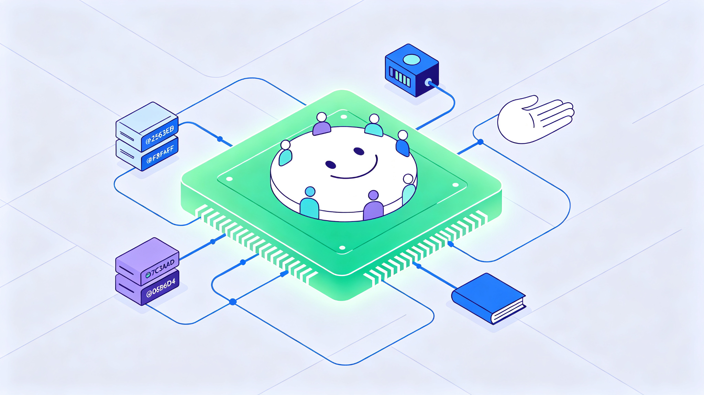
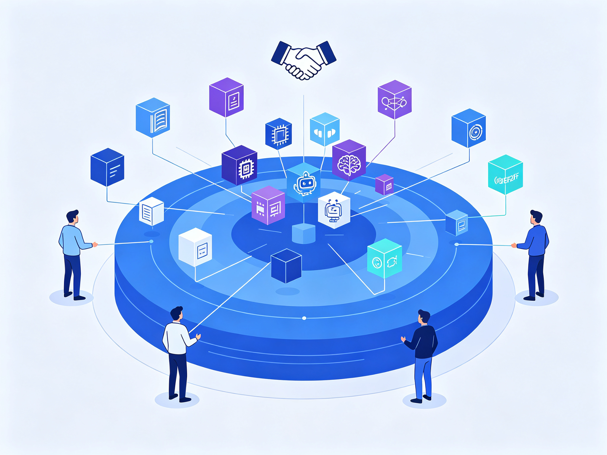
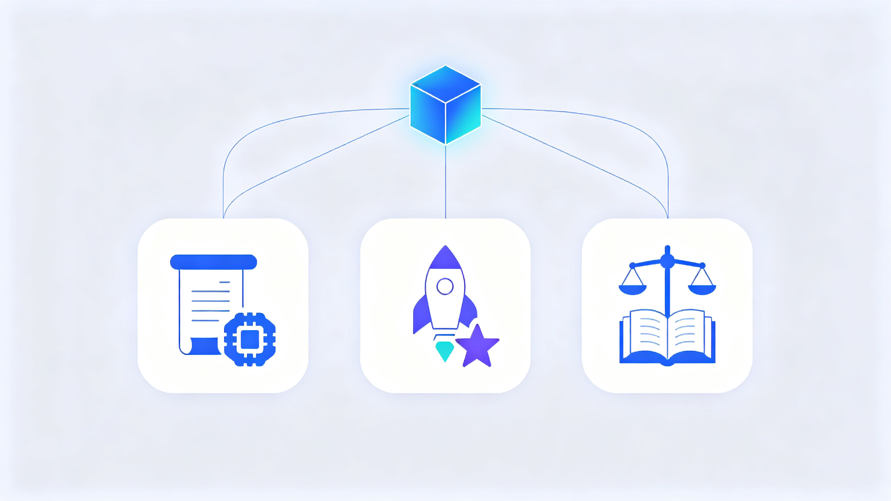
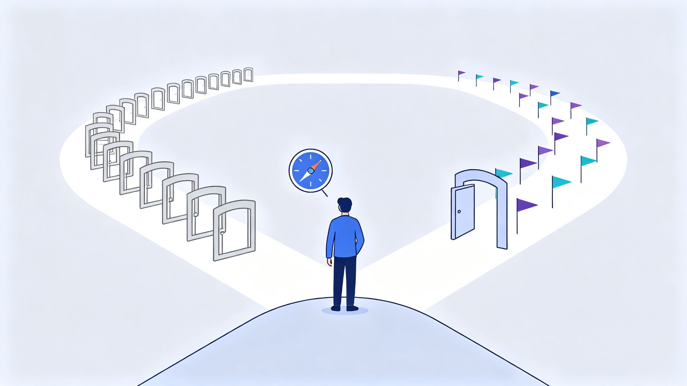

# 英伟达129亿美元买下Hugging Face："AI界的GitHub"易主，普通人该关心什么

> 2026-09-16 ｜ 小智科技

作者｜小智

大家好，我是小智。

这两天AI圈最炸的消息，莫过于英伟达官宣收购Hugging Face。129亿美元，约合人民币869亿元——很多人第一反应是：一家不训练GPT、不造芯片、也不做云的公司，凭什么值这么多钱？

这期咱们把它掰开揉碎讲清楚：英伟达到底买了什么、为什么非买不可，以及最重要的——这事跟咱们普通人有什么关系。

📌 本文看点：

- 129亿美元买下"AI界的GitHub"，钱花在哪了
- Hugging Face从"陪聊机器人"到AI基础设施的十年
- 黄仁勋的算盘：卖铲子的人，为什么买广场
- 开源AI最大的"中立国"被收编，意味着什么
- 中国、美国、欧洲，各自在盘算什么
- 普通人该高兴，还是该担心

---

## 01 先看这笔交易：129亿美元，到底买了什么

9月3日（美国当地时间），英伟达CEO黄仁勋在官方博客宣布：英伟达已同意以**129.303亿美元**（约合人民币868.61亿元）收购Hugging Face。交易预计2027年上半年完成，还需通过监管审批。

这不是突然袭击。8月26日，美国科技媒体The Information率先披露双方已达成协议；消息传出的次日，英伟达股价大涨8.74%，收报227.98美元，单日市值增加约4420亿美元——这是全球股市史上第二大单日市值增量。

价格贵不贵？非常贵。据The Information报道，Hugging Face年化收入约1.5亿美元，收购对价约为其年化收入的80余倍，市销率约86倍。作为对照，2018年微软收购GitHub花了75亿美元，约为当年收入的25倍。

英伟达买的显然不是现金流，而是Hugging Face在AI世界里的**位置**。

**卖铲子的人，买下了淘金者的广场。**

---

## 02 Hugging Face是什么：从"陪聊机器人"到"AI界的GitHub"

很多人以为Hugging Face是个"模型网站"，其实它的起点完全不是这样。

2016年，Clément Delangue等三位创始人在纽约创办了这家公司，最初的产品是一款"陪你聊天的机器人"——用户可以给它起名字、交换表情，主打一个陪伴。2018年，公司每天要处理约100万条消息。

真正的转折发生在2017年。Google发表《Attention Is All You Need》，Transformer架构横空出世，BERT、GPT等预训练模型接连出现。模型越来越强，问题也越来越现实：论文出来了，普通开发者却很难把模型用起来——不同模型有不同代码、不同配置、不同调用方式，换一个模型等于重新学一套工程。

Hugging Face干了一件大事：2018年，他们把主流模型做进一个统一的开源库Transformers。几行代码，就能下载、调用、微调主流模型。这个项目在GitHub上很快突破10万星。2020年，Hugging Face Hub上线，模型、数据集、在线演示开始在同一平台汇聚。

从此它一路长成了"AI界的GitHub"：开发者在这里发现模型、下载模型、微调模型、发布自己的模型，还能直接跑在线演示。

今天的Hugging Face有多大？按黄仁勋官宣博客的口径：**超过1800万名开发者、300万个模型、50万个数据集、100万个应用**，超过20万家公司靠它做模型的发现、评估、定制和部署。

为什么这个位置这么难替代？因为单个模型文件可以搬走，但围绕模型长出来的关系网搬不走：模型说明、下载量、讨论、微调版本、量化版本、几十上百个衍生模型、配套工具链——这些才是一个平台的真正资产。

可以这样理解：GitHub之于代码，就是Hugging Face之于AI模型。

---

## 03 英伟达为什么非买不可："卖铲子"的巨头，看上了淘金者的广场

英伟达的逻辑，一句话就能说清：**模型越多、跑模型的人越多，训练和推理对GPU的需求就越大。**

黄仁勋在采访里说得更直白：英伟达一半的业务，早已由开源模型驱动。开放模型让企业能自主掌控模型和数据，不用把一切绑在闭源服务商身上；而企业跑模型，就要买算力——这就是英伟达的生意。

为了这笔生意，英伟达这两年一直在重仓开源：今年3月宣布未来五年投入260亿美元构建开放模型生态，组建了包括Mistral、Perplexity、Cursor等在内的Nemotron联盟，还宣布推进至少1万亿参数的开源模型Nemotron 4。而Hugging Face，正是开放模型最大的分发入口。

有意思的是，这笔收购还是Hugging Face主动找上门的。今年夏天，Hugging Face团队意识到开源AI到了一个需要更多算力、更大规模、更高影响力的节点——再加上闭源模型接连暴露安全问题，让他们更加确信"只有开源才能兜住AI安全的底"。于是他们主动找到黄仁勋，说"我们想把开源AI做大"，黄仁勋回了一句：**"那就一起做。"**

据黄仁勋透露，当时市场上有多家竞购方，他原本希望Hugging Face保持独立运营，但形势不允许："我本想让它独立，但有其他竞购者。"最后英伟达以129亿美元高价接盘，还配套了**10亿美元的人才留任计划**，Hugging Face创始团队和全体员工都将留下。

要知道，就在一年前，Hugging Face还拒绝过英伟达5亿美元的投资要约，理由是不希望出现一个能影响决策的主导投资者。从"拒绝入股"到"主动卖身"，只隔了不到一年——说明开源AI这场仗，已经打到拼资源的阶段了。

---

## 04 对AI界：从"中立广场"到"巨头后院"？

Hugging Face过去有个外号，叫"AI界的瑞士"——它同时支持英伟达，也支持AMD、英特尔等英伟达的竞争对手，谁的模型都托管，谁的硬件都兼容。这种中立，是整个开源生态信任它的基础。

现在，"瑞士"被"军火商"买下了。

最直接的担忧是：一个中立平台变成行业最强势基础设施公司的资产，它还能保持中立吗？英国科技媒体The Register的评价很尖锐：监管机构应该阻止这笔交易，因为这相当于**"不允许汽车制造商收购主要的燃料分销渠道"**。

更微妙的是，英伟达不需要做任何粗暴的事，就能悄悄改变竞争天平：给自家产品更完整的文档、让新模型第一时间在英伟达硬件上跑通、用廉价的英伟达算力补贴开发者……这些"软倾斜"很难被抓住把柄，但足以影响开发者用脚投票的方向。

历史也提供过警示。2018年微软75亿美元收购GitHub时，社区同样恐慌，事后微软确实保持了GitHub多年的独立。但2025年以后，GitHub与微软AI战略的组织边界明显变薄，独立的GitHub CEO也不再设立。

当然，也要看到利好的一面：Hugging Face是资本密集型生意，存储海量模型和数据、提供海量下载带宽都极其烧钱。有了英伟达的钱和基础设施，平台大概率会更稳、更快、更安全。双方也承诺：Hugging Face继续开放，继续支持多云、多加速器，不强制绑定英伟达。

**"开放"不是交易完成时就能确认、并且永久不变的状态**——这句话，值得所有依赖开源生态的人记下来。

---

## 05 中国、美国、欧洲，各自在盘算什么

先说中国。

短期看，影响有限：DeepSeek、Qwen、GLM等国产模型早已形成"双发布"惯例——同一时间在Hugging Face和国内平台（如阿里魔搭ModelScope）同步发布，并不依赖单一渠道。

但长期看，有两点值得注意。第一，中国其实是Hugging Face生态最大的受益者之一：以阿里Qwen为例，它在Hugging Face上的衍生模型多达15.1万个，全球第一，排在第二的谷歌只有8.3万个；而中国开源模型的全球下载占比已经达到41%，首次超过美国。第二，如果平台未来的推荐算法、下载镜像、推理工具都向英伟达倾斜，国产芯片（昇腾、寒武纪等）的适配成本会更高，国产模型出海的"无摩擦通道"可能变窄。

这反而会加速一件事：国产开源平台的自主建设。阿里魔搭目前已有约2500万用户、17万个开源模型；开源中国旗下的模力方舟在信创领域市占率超过80%。有分析认为，**"入口自主"很可能会和"算力自主"一样，被摆上桌面。**

再说美国。

美国面临的主要是反垄断审查。英伟达在AI芯片市场占据约81%的份额，再拿下全球最大的开源模型分发平台，等于"芯片+软件+模型+社区"全线打通。这笔交易触发美国HSR反垄断申报，FTC和司法部都会介入审查；欧盟的并购审查预计也会全面展开，英国的监管机构同样可能跟进。

再说欧洲。

欧洲的心情最复杂。Hugging Face是法国-美国公司，总部在巴黎，欧洲的Mistral、Aleph Alpha等开源实验室都依赖它发布模型。交易完成后，欧洲将同时面对两个"卡脖子"环节：芯片层（英伟达）和分发层（英伟达旗下的Hugging Face）。欧盟正在讨论数字市场法是否适用于"AI仓库"这类基础设施，也有声音担忧这会威胁欧洲的数字主权。

当然也有另一种声音：英伟达的注资反而可能让欧洲开源AI获得更多资源，甚至成为欧洲摆脱"中美夹击"的一条路——但持这种看法的人目前是少数。

---

## 06 对我们普通人：好处、风险、该做什么

先给结论：对绝大多数人，这笔交易短期几乎没有直接影响。你用豆包、ChatGPT、文心一言，模型托管在哪台服务器上，跟你没关系。

对不同的人，感受会不同：

- 如果你只是用AI——基本无感，该用还用，免费的开源模型大概率继续免费。
- 如果你做开发、做产品——短期可能更爽：Hugging Face有了钱和算力，平台会更稳更快，推理服务可能更便宜。但要注意，别把工作流焊死在单一平台上。
- 如果你是学生或研究者——好消息是开源模型依然免费开放，未来几年应该还是"想下就下"。
- 如果你是企业——数据主权和模型自主的问题会越来越重要，选型时要给自己留退路。

那普通人到底该做什么？三件事：

第一，重要的模型和数据集，别只存在一个平台。多平台备份，魔搭、GitHub、官方渠道都留一份。

第二，别赌单一生态。做开发，别只围着英伟达的CUDA转，保持"模型能跑在别家芯片上"的能力，你的选择权才在自己手里。

第三，盯住监管。这笔交易要到2027年上半年才完成，反垄断审查的结果可能改变整件事的走向。

**你不需要知道模型存在哪个服务器，但你要知道，你的选择是在变多，还是在变少。**

---

## 07 小智说两句

聊完这些，我说三个自己的判断。

第一，"卖铲子的人，买下了淘金者的广场。"英伟达从卖算力，走向算力、分发、生态通吃——这是AI行业从"淘金热"走向"收编期"的标志。巨头开始抢的不是模型，而是**分发权**。

第二，中立不是一句承诺，而是一种能力。Hugging Face过去的中立，来自"谁都得罪不起"；现在它背后站着一个最大的金主，中立与否，要看制度设计，也要看利益结构怎么摆。

第三，对普通人，别恐慌，也别躺平。开源AI大概率还会继续免费、继续好用，但"免费"的前提从来不是善良，而是有人愿意买单。现在买单的人出现了——你只需要想清楚：自己是多准备几条路，还是把身家性命押在一条路上。

一句话总结：**技术还在狂奔，但这条路上开始出现"收费站"了。对普通人来说，最好的姿势是：多用、多备份、别把鸡蛋放在一个篮子里。**

你平时在Hugging Face下载过模型吗？对这129亿美元的收购，你怎么看？评论区聊聊。

---

**资料来源**（核验日期 2026-09-16）：

- 英伟达官方博客《NVIDIA 将收购 Hugging Face》
- 新浪财经《129亿美元买下"AI界GitHub"：英伟达在下什么棋？》
- 36氪《129亿美元卖身英伟达之后，是时候重新理解Hugging Face了》
- 虎嗅网（InfoQ）《Hugging Face太重要，绝不能落入英伟达手中？》
- 电子工程专辑《英伟达129亿美元收购Hugging Face：开源AI生态控制权易主》
- 新浪财经《英伟达拟以129亿美元收购Hugging Face，开源生态进入"收费站"时代》
